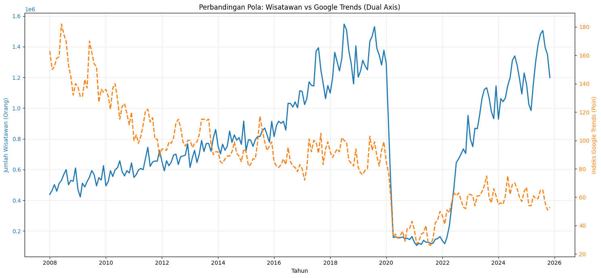
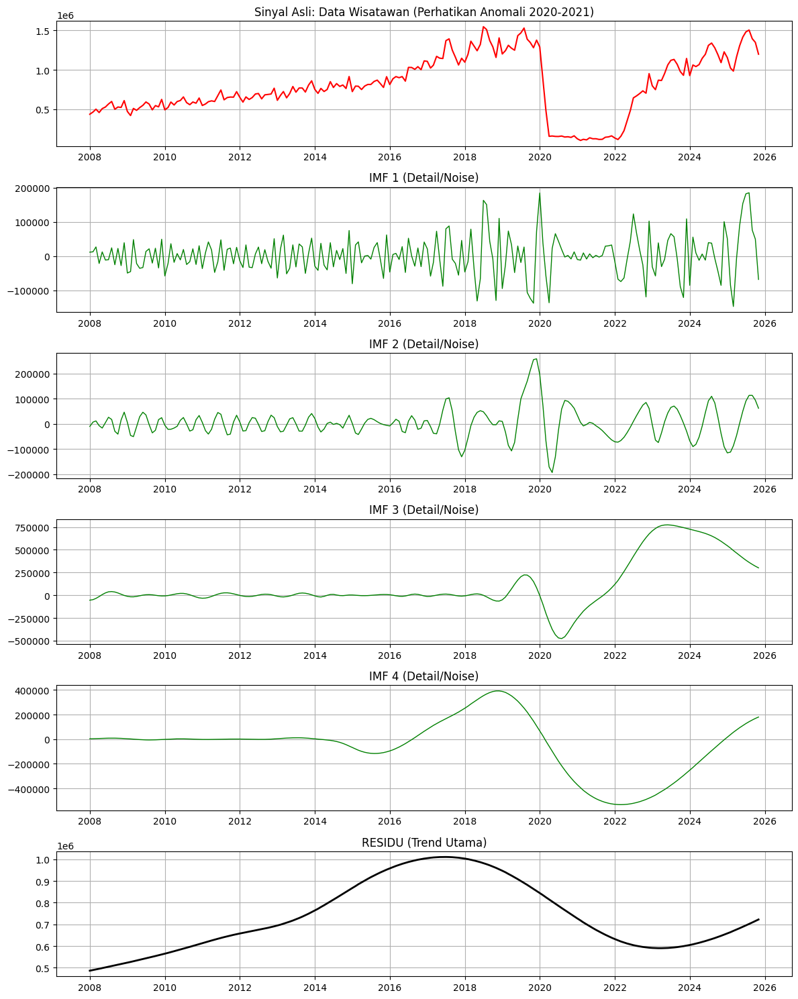
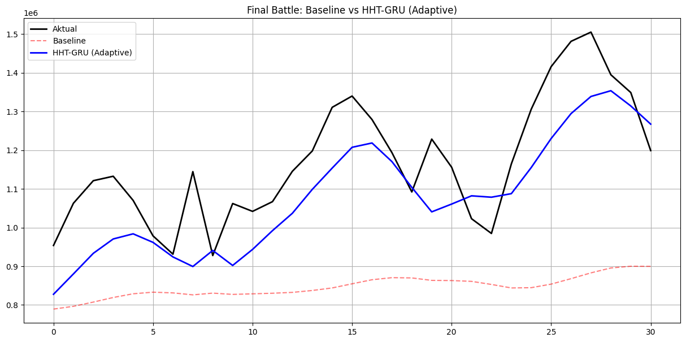

# Peramalan Kedatangan Wisatawan Menggunakan GRU dan EMD

Penelitian peramalan jumlah kedatangan wisatawan bulanan menggunakan _Gated Recurrent Unit_ (GRU) dengan pendekatan dekomposisi sinyal _Empirical Mode Decomposition_ (EMD) dan Google Trends sebagai variabel pendukung.

## Daftar Isi

- [Tentang Proyek](#tentang-proyek)
- [Tujuan Penelitian](#tujuan-penelitian)
- [Metodologi](#metodologi)
- [Visualisasi Data](#visualisasi-data)
- [Model yang Digunakan](#model-yang-digunakan)
- [Rancangan Eksperimen](#rancangan-eksperimen)
- [Metrik Evaluasi](#metrik-evaluasi)
- [Struktur Repository](#struktur-repository)
- [Kebutuhan Sistem](#kebutuhan-sistem)
- [Cara Menjalankan Notebook](#cara-menjalankan-notebook)
- [Keterbatasan](#keterbatasan)
- [Penulis](#penulis)
- [Referensi dan Sitasi](#referensi-dan-sitasi)
- [Lisensi](#lisensi)

## Tentang Proyek

Proyek ini merupakan implementasi penelitian skripsi di bidang Teknik Informatika yang berjudul:

**“Implementasi Gated Recurrent Unit untuk Peramalan Kedatangan Wisatawan dengan Preprocessing Hilbert-Huang Transform”.**

Penelitian ini berangkat dari permasalahan peramalan jumlah kedatangan wisatawan yang memiliki pola dinamis, fluktuatif, dan mengalami perubahan signifikan pada periode tertentu. Karakteristik tersebut menjadi tantangan bagi model peramalan dalam mempelajari pola historis secara optimal.

Untuk mengkaji permasalahan tersebut, penelitian ini mengeksplorasi penggunaan dekomposisi sinyal sebagai tahap prapemrosesan sebelum pemodelan GRU. Data Google Trends turut digunakan sebagai variabel pendukung untuk merepresentasikan minat pencarian terkait pariwisata.

Repository ini mendokumentasikan notebook, dataset, dan visualisasi yang berkaitan dengan eksperimen penelitian.

## Tujuan Penelitian

Penelitian ini memiliki tujuan sebagai berikut:

1. Menerapkan pendekatan preprocessing berbasis Hilbert-Huang Transform pada data kedatangan wisatawan dan variabel pendukung yang digunakan dalam penelitian.
2. Mengimplementasikan GRU untuk mempelajari pola historis dan melakukan peramalan jumlah kedatangan wisatawan bulanan.
3. Membandingkan kinerja GRU baseline dengan model GRU berbasis dekomposisi sinyal untuk mengetahui pengaruh preprocessing terhadap hasil peramalan.
4. Mengevaluasi kinerja model menggunakan Root Mean Squared Error (RMSE), Mean Absolute Error (MAE), dan Mean Absolute Percentage Error (MAPE).

Melalui penelitian ini, diharapkan dapat diperoleh gambaran mengenai pemanfaatan dekomposisi sinyal dan _deep learning_ untuk peramalan deret waktu di bidang pariwisata.

## Metodologi

Tahapan penelitian yang tercakup dalam notebook meliputi:

1. **Pengumpulan data** — Memuat data kedatangan wisatawan dari Badan Pusat Statistik (BPS) dan data Google Trends.
2. **Persiapan data** — Menyelaraskan data berdasarkan periode bulanan dan menyiapkan variabel untuk pemodelan.
3. **Dekomposisi sinyal** — Menggunakan Empirical Mode Decomposition (EMD) untuk memisahkan sinyal menjadi beberapa komponen _Intrinsic Mode Functions_ (IMF) dan residu.
4. **Pembentukan jendela waktu** — Menyusun data historis menjadi urutan sepanjang 12 bulan sebagai masukan model.
5. **Pemodelan GRU** — Melatih model baseline dan model berbasis dekomposisi sinyal.
6. **Rekonstruksi prediksi** — Menggabungkan prediksi komponen untuk memperoleh prediksi akhir pada model berbasis dekomposisi.
7. **Evaluasi** — Membandingkan hasil prediksi dengan data aktual menggunakan metrik evaluasi regresi.

**Catatan metodologi:** Notebook yang tersedia menggunakan EMD melalui pustaka `EMD-signal`. EMD merupakan bagian dari pendekatan Hilbert-Huang Transform, tetapi penerapan EMD saja tidak membuktikan bahwa seluruh tahapan HHT, termasuk analisis spektral Hilbert, telah diimplementasikan. Oleh karena itu, deskripsi kode harus dibedakan dari metodologi yang tercantum dalam judul skripsi.

## Visualisasi Data

### 1. Pola Kedatangan Wisatawan dan Google Trends

Grafik berikut memperlihatkan pola historis jumlah kedatangan wisatawan dan indeks Google Trends. Perubahan yang terlihat sekitar periode 2020–2021 menunjukkan adanya anomali besar pada data yang perlu diperhatikan dalam analisis deret waktu.



### 2. Hasil Dekomposisi EMD

Dekomposisi EMD memisahkan sinyal asli menjadi beberapa komponen IMF dan residu. Komponen-komponen tersebut merepresentasikan pola osilasi pada skala yang berbeda dan bagian sinyal yang tersisa.



### 3. Perbandingan Aktual dan Prediksi

Visualisasi berikut merupakan keluaran eksperimen yang tersimpan dalam notebook, yang membandingkan data aktual dengan prediksi GRU baseline dan model berbasis dekomposisi.



**Catatan:** Grafik merupakan keluaran eksperimen sebelumnya dan belum dianggap sebagai hasil evaluasi final yang telah direproduksi secara independen. Rentang tanggal, keselarasan target, dan prosedur evaluasi perlu dipastikan sebelum angka hasil dicantumkan sebagai kesimpulan penelitian.

## Model yang Digunakan

### GRU Baseline

GRU baseline digunakan sebagai model pembanding tanpa tahap dekomposisi sinyal. Model memanfaatkan urutan historis untuk mempelajari pola temporal dan menghasilkan prediksi jumlah kedatangan wisatawan.

### Model GRU Berbasis EMD

Model berbasis EMD menggunakan hasil dekomposisi sinyal sebagai target komponen yang dipelajari oleh model GRU. Prediksi komponen kemudian dijumlahkan untuk memperoleh prediksi akhir.

Pendekatan ini dieksplorasi untuk mengkaji apakah pemisahan sinyal dapat membantu model mempelajari pola data yang lebih kompleks.

## Rancangan Eksperimen

Rancangan eksperimen yang direncanakan untuk evaluasi terstruktur adalah sebagai berikut:

| Komponen                 | Pengaturan                          |
| ------------------------ | ----------------------------------- |
| Target prediksi          | Jumlah kedatangan wisatawan bulanan |
| Variabel pendukung       | Google Trends                       |
| Panjang jendela historis | 12 bulan                            |
| Strategi prediksi        | _Rolling one-step ahead_            |
| Data pelatihan           | Januari 2008–Desember 2022          |
| Data validasi            | Januari–Desember 2023               |
| Data pengujian           | Januari 2024–Desember 2025          |
| Metrik evaluasi          | RMSE, MAE, MAPE                     |

Rancangan tersebut perlu dibedakan dari eksperimen lama yang tersimpan dalam notebook. Notebook lama menggunakan pembagian data 80:20 dan belum menerapkan pemisahan validasi serta pengujian secara terpisah sesuai rancangan di atas.

Evaluasi yang adil mengharuskan kedua model menggunakan tanggal target pengujian, target aktual, dan asumsi ketersediaan fitur yang sama. Data pengujian tidak boleh digunakan untuk memilih epoch maupun konfigurasi model.

## Metrik Evaluasi

Kinerja model dievaluasi menggunakan tiga metrik berikut:

- **RMSE (_Root Mean Squared Error_)** — Mengukur akar dari rata-rata kuadrat kesalahan prediksi. Metrik ini lebih sensitif terhadap kesalahan yang besar.
- **MAE (_Mean Absolute Error_)** — Mengukur rata-rata nilai absolut selisih antara prediksi dan nilai aktual.
- **MAPE (_Mean Absolute Percentage Error_)** — Mengukur rata-rata kesalahan absolut dalam bentuk persentase terhadap nilai aktual.

Semakin rendah nilai metrik tersebut, semakin kecil kesalahan prediksi pada data evaluasi yang sama. MAPE perlu ditafsirkan dengan hati-hati apabila nilai aktual bernilai nol atau sangat kecil.

## Struktur Repository

```text
.
├── README.md
├── requirements.txt
├── .gitignore
├── assets/
│   ├── data-overview.png
│   ├── emd-decomposition.png
│   └── forecast-comparison.png
├── Data-mentah/
│   ├── BPS.csv
│   └── GOOGLE_TRENDS.csv
├── Main-data/
│   └── DATASET_SIAP_PAKAI.csv
└── GRU_BASE_AND_HTT_GRU_FIXED.ipynb
```

### Keterangan Berkas

| Berkas atau folder                 | Keterangan                                                     |
| ---------------------------------- | -------------------------------------------------------------- |
| `Data-mentah/`                     | Berisi dataset mentah yang digunakan dalam penelitian.         |
| `Main-data/`                       | Berisi dataset yang telah disiapkan untuk eksperimen.          |
| `assets/`                          | Menyimpan gambar untuk dokumentasi repository.                 |
| `GRU_BASE_AND_HTT_GRU_FIXED.ipynb` | Notebook utama untuk pemrosesan data, pemodelan, dan evaluasi. |
| `requirements.txt`                 | Daftar pustaka Python yang diperlukan.                         |
| `.gitignore`                       | Mengatur berkas yang tidak perlu dilacak oleh Git.             |

## Kebutuhan Sistem

Proyek ini menggunakan Python dan beberapa pustaka untuk pengolahan data, visualisasi, dekomposisi sinyal, dan pemodelan _deep learning_.

Pustaka utama yang digunakan:

- `pandas`
- `numpy`
- `matplotlib`
- `EMD-signal`
- `scikit-learn`
- `tensorflow`

Notebook juga menggunakan integrasi Google Colab untuk mengakses Google Drive. Versi Python dan pustaka yang kompatibel perlu diverifikasi sebelum eksperimen dijalankan kembali.

## Cara Menjalankan Notebook

Notebook awalnya dikembangkan menggunakan Google Colab dan membaca dataset melalui path Google Drive.

Langkah menjalankan notebook pada lingkungan asalnya:

1. Buka notebook menggunakan Google Colab.
2. Siapkan dataset `DATASET_SIAP_PAKAI.csv` pada lokasi Google Drive yang sesuai dengan path di notebook.
3. Pastikan pustaka yang diperlukan tersedia pada runtime.
4. Jalankan sel notebook secara berurutan.
5. Periksa visualisasi, proses pelatihan, hasil prediksi, dan metrik evaluasi.

Notebook belum sepenuhnya disesuaikan untuk dijalankan langsung di VS Code karena masih memiliki ketergantungan pada Google Colab dan path Google Drive tertentu.

## Keterbatasan

- Hasil eksperimen bergantung pada versi dataset, pustaka, konfigurasi model, dan prosedur evaluasi.
- Indeks Google Trends merupakan indikator minat pencarian dan tidak secara langsung merepresentasikan jumlah wisatawan.
- EMD dapat mengalami efek batas (_endpoint effects_) dan menghasilkan karakteristik komponen yang berbeda ketika rentang data berubah.
- Dekomposisi yang menggunakan informasi dari periode pengujian dapat menyebabkan kebocoran data (_data leakage_).
- Evaluasi pada satu periode pengujian tidak menjamin kinerja yang sama pada periode lainnya.
- Repository ini merupakan dokumentasi penelitian dan bukan sistem peramalan operasional resmi.

## Penulis

**M. Reza Pahlevi**  
Program Studi Teknik Informatika  
Universitas Muhammadiyah Riau, Indonesia

## Referensi dan Sitasi

Informasi bibliografi lengkap skripsi dan referensi ilmiah terkait akan dicantumkan setelah diverifikasi.

Jika menggunakan kode, dataset olahan, atau hasil penelitian ini dalam karya ilmiah, cantumkan sitasi yang sesuai terhadap sumber data dan penelitian terkait.

## Lisensi

Lisensi repository akan ditentukan setelah kepemilikan kode dan izin distribusi dataset diperiksa. Dataset dari sumber eksternal tetap tunduk pada ketentuan penggunaan dan distribusi dari sumber masing-masing.
